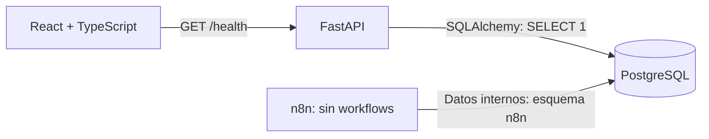
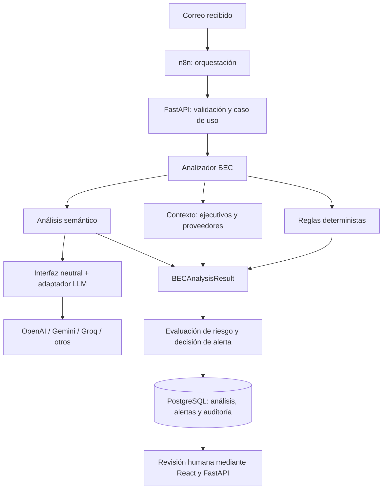

# Arquitectura de BEC Guard

## Propósito y alcance actual

BEC Guard es un proyecto académico de Ingeniería de Software para detectar y gestionar
Business Email Compromise (BEC) / fraude ejecutivo. Se construye incrementalmente.

**Fases 0 y 1:** definición conceptual y scaffold ejecutable. Solo están implementados
la comprobación de salud, su consulta desde React y la infraestructura local.
No existen todavía análisis de correos, scoring, autenticación ni integraciones de IA.

## Arquitectura

Un monolito modular FastAPI concentra la lógica de negocio. React consume su API REST.
PostgreSQL es la fuente de verdad; n8n orquesta y llama a FastAPI, sin duplicar reglas
de negocio. No se necesitan microservicios, Redis ni colas en esta etapa.

Los cuatro servicios se ejecutan con Docker Compose. Los puertos publicados solo
escuchan en `127.0.0.1`. Es una configuración de desarrollo local.

## Responsabilidades

| Componente | Responsabilidad |
| --- | --- |
| Frontend | Presentación y comunicación REST. Hoy muestra disponibilidad del backend; posteriormente permitirá revisión humana. |
| FastAPI | Validación de contratos, lógica del dominio y acceso a persistencia. Hoy ejecuta una consulta de conectividad con SQLAlchemy. |
| PostgreSQL | Persistencia de negocio futura y datos internos de n8n. Aún no hay tablas del dominio BEC. |
| n8n | Orquestar recepción y llamadas a FastAPI en el futuro. Hoy solo se provisiona su instancia vacía. |
| LangChain (futuro) | Facilitar análisis semántico dentro del backend, detrás de una interfaz propia. No determina el contrato del dominio. |
| Adaptadores LLM (futuros) | Traducir solicitudes y respuestas de OpenAI, Gemini, Groq u otros al contrato neutral de BEC Guard. |

## Organización del backend

- `api/`: rutas HTTP.
- `core/`: configuración y conexión a la base de datos.
- `schemas/`: contratos Pydantic públicos implementados; hoy únicamente salud.
- `models/`: reservado para modelos SQLAlchemy futuros.
- `services/`: reservado para casos de uso futuros.

Se utiliza SQLAlchemy síncrono con psycopg y rutas síncronas de FastAPI. Es suficiente
para este alcance y evita añadir complejidad async. La conexión se crea por instancia
de aplicación y se libera al cerrarla. No se ejecuta `create_all` ni se crean tablas
de prueba. Las migraciones del dominio se incorporarán cuando exista un modelo SQL.

`GET /health` comprueba disponibilidad de la API y PostgreSQL mediante `SELECT 1`.
Devuelve 503 cuando falla la base de datos. No se añade una segunda ruta equivalente.
Vite reenvía `/health` al backend: el navegador usa el mismo origen, sin requerir CORS.
El servidor Vite en Compose es exclusivamente de desarrollo.

## Persistencia local

Una instancia PostgreSQL contiene el esquema `public`, reservado para BEC Guard,
y `n8n`, para tablas administradas por n8n. El esquema se inicializa al crear el
volumen por primera vez. Se comparte un usuario local para simplificar el scaffold;
los esquemas separan organización, no permisos. Antes de un despliegue real habrá
que definir usuarios y permisos independientes. Las tablas internas que crea n8n
no son entidades BEC.

Los volúmenes `postgres_data` y `n8n_data` persisten los datos y la configuración de
n8n. Sus claves de cifrado se generan y conservan en su volumen. No se exportan al
repositorio. Los workflows exportados se guardarán en `n8n/workflows/`, sin secretos.

## Flujo futuro (solo diseño)

FastAPI será responsable de combinar señales y validar el resultado; un proveedor
LLM no decidirá por sí solo acciones financieras ni sustituirá la revisión humana.
El scoring y los criterios de creación de alertas todavía no están definidos.
Cambiar de proveedor no deberá modificar consumidores REST ni entidades de negocio.
No se implementan ahora interfaces vacías de IA, agentes, prompts ni SDKs.

## Referencias técnicas

- [FastAPI: contenedores](https://fastapi.tiangolo.com/deployment/docker/).
- [Vite: inicio y requisitos](https://vite.dev/guide/).
- [n8n: instalación Docker y PostgreSQL](https://docs.n8n.io/hosting/installation/docker/).
