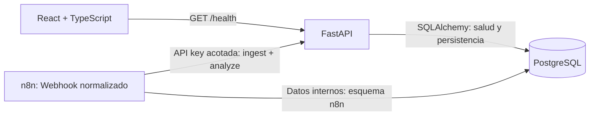
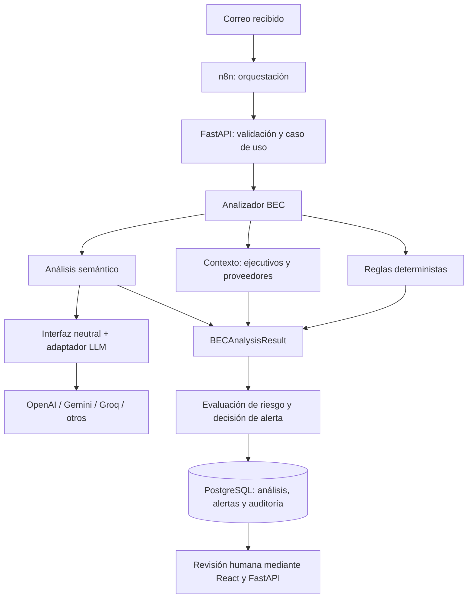

# Arquitectura de BEC Guard

## Propósito y alcance actual

BEC Guard es un proyecto académico de Ingeniería de Software para detectar y gestionar
Business Email Compromise (BEC) / fraude ejecutivo. Se construye incrementalmente.

**Fases 0–6:** scaffold, persistencia con Alembic, autenticación
JWT/Argon2id, contexto, ingestión de emails, parser MIME y auditoría atómica.
Fase 5 añade reglas, LangChain multiproveedor, scoring y EmailAnalysis persistido.
Se conserva la pantalla de salud y la infraestructura local. No hay frontend de
autenticación/análisis ni HITL. Fase 6 añade alertas automáticas y Webhook n8n.

## Arquitectura

Un monolito modular FastAPI concentra la lógica de negocio. React consume su API REST.
PostgreSQL es la fuente de verdad; n8n orquesta y llama a FastAPI, sin duplicar reglas
de negocio. No se necesitan microservicios, Redis ni colas en esta etapa.

Los cuatro servicios se ejecutan con Docker Compose. Los puertos publicados solo
escuchan en `127.0.0.1`. Es una configuración de desarrollo local.

## Responsabilidades

| Componente | Responsabilidad |
| --- | --- |
| Frontend | Presentación y comunicación REST. Hoy muestra disponibilidad del backend; posteriormente permitirá revisión humana. |
| FastAPI | Validación de contratos, lógica del dominio y acceso a persistencia. Gestiona autenticación, contexto organizacional y auditoría; conserva la salud de infraestructura. |
| PostgreSQL | User, AuditLog, ExecutiveContact, Vendor, Email, EmailAnalysis y BECAlert en public; datos internos de n8n en su propio esquema. |
| n8n | Webhook autenticado → ingestión/análisis mediante API key acotada → ALERT/NO_ALERT/ERROR. Sin reglas BEC ni scoring propios. |
| LangChain | Un chat model, prompt y structured output validado dentro del backend, sin agentes/tools. |
| Adaptadores LLM | OpenAI, Gemini o Groq; solo se instancia el proveedor configurado al analizar. |

## Organización del backend

- `api/`: rutas HTTP.
- `core/`: configuración y conexión a la base de datos.
- `schemas/`: contratos Pydantic de salud, auth, contexto e ingestión; evaluación separada.
- `models/`: Base común, User, Role, AuditLog, ExecutiveContact, Vendor y Email.
- `services/`: auth, auditoría, contexto, ingestión, parser MIME y loader de evaluación.
- `scripts/`: comando interactivo del primer ADMIN.
- `migrations/` y `alembic.ini`: historial y configuración de Alembic.

Se utiliza SQLAlchemy síncrono con psycopg y rutas síncronas de FastAPI. Es suficiente
para este alcance y evita añadir complejidad async. El engine y la fábrica de
sesiones se crean por instancia de aplicación; el engine se libera al cerrarla.
`get_session` prepara una sesión por petición para futuras rutas. El caso de uso
será responsable de `commit`; cerrar la sesión revierte transacciones pendientes.
No se añade repository pattern ni se exponen rutas CRUD de usuarios.

El proceso web no ejecuta `create_all` ni migraciones. Alembic reutiliza Settings
para su conexión y gestiona las tablas del dominio y alembic_version en public mediante
un comando explícito. La autogeneración excluye otros esquemas y tablas ajenas
a su metadata. El downgrade de validación se ejecuta únicamente en PostgreSQL de
prueba, separado de desarrollo y sin n8n. Consulta [persistencia](persistence.md).

`GET /health` comprueba disponibilidad de la API y PostgreSQL mediante `SELECT 1`.
Devuelve 503 cuando falla la base de datos. No se añade una segunda ruta equivalente.
Vite reenvía `/health` al backend: el navegador usa el mismo origen, sin requerir CORS.
El servidor Vite en Compose es exclusivamente de desarrollo.

## Persistencia local

Una instancia PostgreSQL contiene el esquema `public`, reservado para BEC Guard,
y `n8n`, para tablas administradas por n8n. El esquema se inicializa al crear el
volumen por primera vez. Se comparte un usuario local para simplificar el scaffold;
los esquemas separan organización, no permisos. Antes de un despliegue real habrá
que definir usuarios y permisos independientes. Las tablas internas que crea n8n
no son entidades BEC.

Fase 2A añade exclusivamente User: UUID v4 en la aplicación, Role como enum Python
y texto con CHECK, email único y timestamps con zona horaria. Las migraciones
no crean, eliminan ni recrean el esquema de n8n. CI usa un service container
PostgreSQL exclusivo del job backend para migraciones y pruebas de persistencia.

Fase 2B añade JWT de acceso y consulta del usuario actual, RBAC por rol de DB y
auditoría append-only de eventos de autenticación. El secreto JWT es obligatorio
solo para la API y se configura en el entorno. No hay refresh ni flujos de n8n.
La metadata usa el esquema por defecto con search_path=public para evitar
diferencias falsas de reflexión de claves foráneas. Las migraciones siguen
calificando public y excluyendo n8n. Ver [autenticación](authentication.md).

Fase 3 añade ExecutiveContact y Vendor con GET/POST/PATCH autenticados, permisos
de escritura ADMIN/MANAGER y lookups exactos activos. Recurso y auditoría comparten
un commit. Ver [contexto organizacional](organizational-context.md).

Fase 4 añade Email y contrato normalizado POST/GET, con resumen separado del detalle.
El parser stdlib es interno: no hay conector, workflow ni análisis. El corpus de
evaluación mantiene labels fuera de emails; [ingestión](email-ingestion.md) y
[dataset](dataset.md).

Los volúmenes `postgres_data` y `n8n_data` persisten los datos y la configuración de
n8n. Sus claves de cifrado se generan y conservan en su volumen. No se exportan al
repositorio. Los workflows exportados se guardarán en `n8n/workflows/`, sin secretos.

Fase 5 implementa `Email → reglas/contexto → semántica → scoring → EmailAnalysis`.
POST bloquea el Email para serializar análisis concurrentes y reutilizar COMPLETED;
ERROR es persistido/reintentable con riesgo null. Análisis y evento comparten un
commit. No cambia el estilo síncrono ni incorpora servicios adicionales.
Políticas y límites: [análisis BEC](bec-analysis.md).

Fase 6 integra alert-v1 (COMPLETED >=70) y BECAlert en el mismo commit del pipeline.
La API humana conserva JWT/RBAC; dos POST de automatización usan una key lazy sin
crear usuarios ficticios. n8n importa una credencial Header Auth y URL desde entorno
sin habilitar `$env` en nodos. No se conserva historial de ejecuciones con correos;
los registros temporales se marcan y eliminan mediante pruning periódico.
[Diseño y contratos](alerts-and-orchestration.md) · [operación n8n](../n8n/README.md).

## Flujo futuro (solo diseño)

FastAPI será responsable de combinar señales y validar el resultado; un proveedor
LLM no decidirá por sí solo acciones financieras ni sustituirá la revisión humana.
El scoring hybrid-v1 y la política automática alert-v1 ya existen; recepción real
de correo, notificaciones y revisión humana siguen pendientes.
Cambiar de proveedor no deberá modificar consumidores REST ni entidades de negocio.
Fase 5 incorpora prompts/SDKs con consumidores reales; no se implementan agentes.

## Referencias técnicas

- [FastAPI: contenedores](https://fastapi.tiangolo.com/deployment/docker/).
- [Vite: inicio y requisitos](https://vite.dev/guide/).
- [n8n: instalación Docker y PostgreSQL](https://docs.n8n.io/hosting/installation/docker/).
